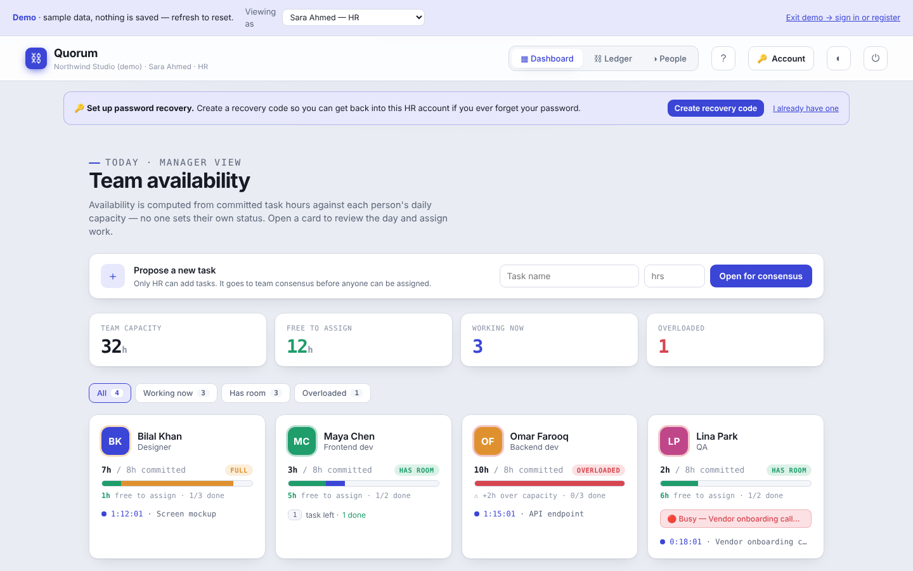
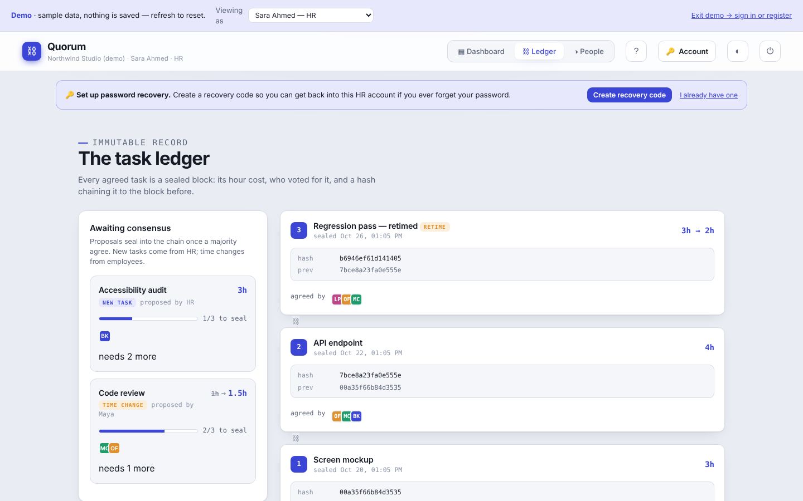

# Quorum: consensus task-hour ledger (demo)

**Live demo:** <https://projects-zeta-pied.vercel.app/quorum?demo>

Quorum is a multi-user workforce app. HR adds employees, everyone signs in separately, and every task, timer and busy status is saved to a database. Nobody sets their own "available" flag. Availability is computed from the task hours each person has committed to that day. The team agrees how long each kind of task should take, and every agreed number is sealed into a hash-chained ledger.

This repository is the **standalone demo build**. It runs the real UI against an in-browser sandbox with sample data. There is no backend, account or API key. Nothing is saved, and a refresh resets everything. The production version, with Supabase auth, Postgres RLS and Edge Functions, is kept private.



| Consensus ledger | First-visit intro |
|---|---|
|  |  |

## What you can try

- **HR dashboard:** team capacity, who has room, who's overloaded, live task timers. Open a person to assign work.
- **Switch who you're viewing as** (banner at the top) to see the employee's "My day" view. Start, pause and finish tasks, or mark yourself busy.
- **Propose a task or a new time estimate.** It goes to a team vote, and once enough people agree it's sealed as a new block on the ledger.
- **Ledger:** every block stores the previous block's hash, so editing history breaks the chain.
- **People:** add employees and set passwords (simulated in the demo).
- Guided tour per role, plus light and dark themes.

## How it works

| Piece | File |
|---|---|
| All screens (dashboard, drawer, my day, ledger, people) | `src/quorum/Quorum.jsx` |
| Demo data + actions. Same shape as the production data hook, so the UI runs unchanged | `src/quorum/useQuorumDemo.js` |
| Load/availability math, timers, ledger hashing | `src/quorum/quorumLogic.js` |
| Animated intro and guided tour | `src/quorum/QuorumIntro.jsx`, `src/quorum/QuorumTour.jsx`, `src/components/ProductIntro.jsx` |

## Run it locally

```bash
npm install
npm run dev        # http://localhost:5173
```

`npm run build` writes a static site to `dist/`. The included GitHub Actions workflow publishes it to GitHub Pages. To turn that on, go to **Settings → Pages → Source: GitHub Actions**.

## Tech

React 18 · Vite · plain CSS (light/dark themes) · production version: Supabase (Postgres + RLS, Auth, Edge Functions)
